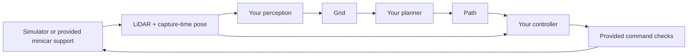

# CEV autonomy onboarding

Build the parts that make a minicar understand obstacles, choose a route, and follow it. You own the algorithms in **`src/student/`**. The simulator connection, vehicle model, safe runner, fixtures, and reports are provided.

The starter deliberately stays stopped. It contains no completed mapper, planner, or path follower.

## Start here

Install Rust and follow [Getting started](docs/getting-started.md) to start ev-sim and the orchestrator and open the simulator page.

```sh
cargo test --locked
cargo run -- setup
cargo run -- observe
```

You should see a stationary vehicle and printed pose/LiDAR measurements. Ctrl-C stops and finalizes the run.

## Your three components

| File | Your job | Test independently |
| --- | --- | --- |
| `src/student/perception.rs` | Turn sensor points into occupied grid cells | `cargo run -- perception` |
| `src/student/planning.rs` | Find a clear route through a supplied map | `cargo run -- planning --scenario detour` |
| `src/student/controls.rs` | Follow a supplied path | `cargo run -- controls` |

Read the short [challenge guide](docs/challenges.md). You can use the suggested algorithms or choose your own. Unfinished components return `None` or a stop command, so the rest of the project remains runnable.

```sh
# Algorithm acceptance tests are initially ignored. Enable them explicitly as you work.
cargo test --test perception -- --ignored
cargo test --test planning -- --ignored
cargo test --test controls -- --ignored

# Once all three components work
cargo run -- autonomous --scenario empty
cargo run -- autonomous --scenario detour
cargo run -- autonomous --scenario blocked
```

Each command writes `results/<mode>-<timestamp>/view.svg`, `updates.csv`, and `summary.json`. Open the SVG in a browser. Use the simulator's Path toggle, Analysis, and Replay for live inspection. A missing collision count is reported as unavailable.

## How it fits together



One ordinary Rust package, one sequential autonomy update per fresh 10 Hz scan. Transport is handled in `src/sim.rs`; student functions use ordinary Rust structs. `src/types.rs` documents units and frames. Grid helpers and path checks do not choose a route for you.

**Simulation training geometry is synthetic, not measured minicar geometry.** Hardware is a maintainer-owned prerequisite: Pi 5, RP2040, LiDAR, IMU, added wheel encoders, calibrated geometry, and encoder/IMU odometry. See [Hardware readiness](docs/hardware.md). This starter does not arm or drive physical hardware.

Useful next reads: [Challenges](docs/challenges.md), [Debugging](docs/debugging.md), [Setup and Git workflow](docs/getting-started.md).
